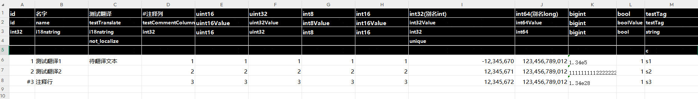
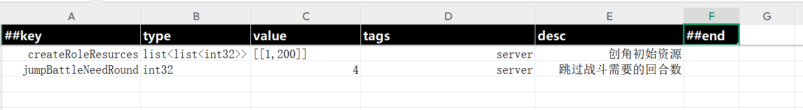
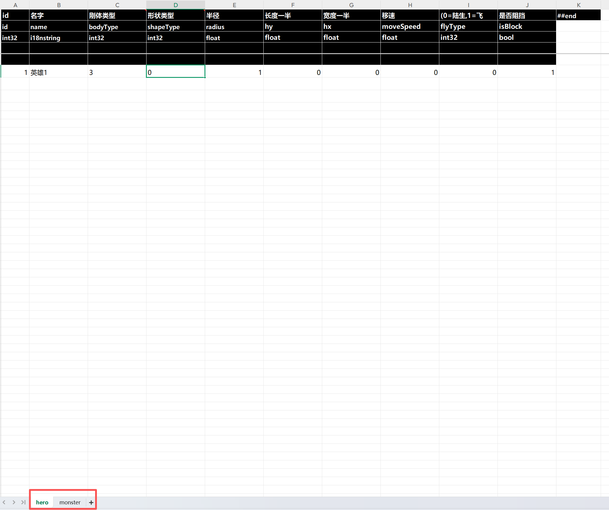

## Table of Contents

[toc]

## 构建

- 依赖项

  - 大于等于python3.10
  - pip install pyinstaller
  - pip install openpyxl
  - pip install Jinja2
- 仅对程序有用,当工具代码改变后,需要重新构建时执行
- 执行 build.bat

[Back to TOC](#table-of-contents)

## 用法

双击 gen.bat，或命令行调用 `xls2cfg.exe` / `python xls2cfg.py`。

正向导表（Excel → 代码/json/binary）可用 `--config`，也可不配文件、把同样字段用参数传入；命令行优先于配置文件。

```text
# 仍可用配置文件
python xls2cfg.py --config=config-client.json

# 不配文件，等价于 config-client.json 的核心字段
python xls2cfg.py --input=../Excel --output=../Output/Client --output-formats=csharp,binary,json,schema --tags=c --namespace=Cfg --pretty=true --gen-meta=true --gen-meta-detail=true --class-name-first-upper=true --field-name-first-upper=true --localize=true --i18n-directory=../Output/I18N --i18n-language=zh_CN --i18n-extension=.po --i18n-export-one-file=true

# 配置文件 + 覆盖个别项
python xls2cfg.py --config=config-client.json --output=../Output/Client2 --tags=c
```

xlsx ↔ schema/json 见下文「schema 输出与 Excel 导入/导出」，同样不需要 `--config`。

### 常用命令速查

| 场景 | 命令要点 |
|---|---|
| Excel → schema/json/binary/csharp | `--from-xlsx=..\Excel\buff@魔法效果.xlsx --output=..\Output\Client --output-formats=schema,json,binary,csharp` |
| schema + json → xlsx | `--from-schema=…schema\buff.json --from-json=…json\buff.json --out-xlsx-dir=..\Excel` |
| schema + json → binary | `--from-schema=…schema\template.json --from-json=…json\template.json --output=… --output-formats=binary` |
| schema + binary → json | `--from-schema=…schema\template.json --from-binary=…binary\template.bytes --output=… --output-formats=json` |
| 批量：schema 目录 + json 目录 → binary | `--from-schema-dir=Assets\Config\Schema --from-json-dir=Assets\Config\Json --output=… --output-formats=binary` |
| 批量：schema 目录 + binary 目录 → json | `--from-schema-dir=Assets\Config\Schema --from-binary-dir=Assets\Config\Binary --output=… --output-formats=json` |
| 从 schema 生成代码 / Tables.cs | `--export-code-from-schema=… --output=… --output-formats=csharp [--export-tables-from-schema=true]` | |

> 批量模式要求目录里每张表都能被对应 schema 读通；遇到旧/坏 bytes 会中断，先单表转换或重新生成坏表。

输出目录固定为：

```text
Output/Client/
  schema/     *.json
  json/       *.json
  binary/     *.bytes
  csharp/     *.cs
```

### C# 运行时（编辑器）

行对象字段默认可为 `readonly`（`fieldReadonly`，可用配置关掉）。`readonly` 时用 `new Hero(jsonNode)` 构造（暂无全参数构造）。`AddRow` / `AddRows` 只对 2D 表（`Dictionary<Id, Row>`）有效，按 `Id`/`id` upsert。`SerializeRow` 按 `Tables.format` 序列化单行（编辑器每行一个文件）；`SerializeTable` 序列化整张 2D 表。

```csharp
Tables.format = Tables.Format.Json; // 或 Format.Binary
var tables = new Tables(name => File.Exists(path) ? File.ReadAllBytes(path) : Array.Empty<byte>());
Tables.Instance = tables;

var hero = new Hero(jsonNode);
tables.AddRow(tables.Hero, hero);

File.WriteAllBytes(rowPath, tables.SerializeRow(hero));
File.WriteAllBytes(tablePath, tables.SerializeTable(tables.Hero));
```

`ByteStream.ToBytes()` 用于 binary 写出；运行时需同步到客户端/服务端的 `ByteStream.cs`。

等级表合并视图（`SkillWithLevel` 等）见下文「等级表与 WithLevel」；运行时通过 `MergeTable(baseTable, levelTable)` 合并，无独立 data 文件。

### Go 运行时（编辑器）

Go 字段可直接赋值；也可用 `DeserializeFromJson` 从 JSON 填充。`AddRow` / `AddRows` / `SerializeTable` 只对 2D 表（`map[Id]*Row`）有效，按 `Id` upsert。`SerializeRow` 按包级 `Format` 序列化单行。Go 无方法泛型，这些 API 为包级函数（与现有 `DeserializeTableFromJson` 一致）。

```go
Format = Format_Json // 或 Format_Binary
tables, err := NewTables(func(name string) ([]byte, error) {
    path := filepath.Join(dir, name+".json") // binary 则 .bytes
    data, err := os.ReadFile(path)
    if os.IsNotExist(err) {
        return []byte{}, nil // 空表
    }
    return data, err
})

hero := &Hero{}
_ = hero.DeserializeFromJson(jsonBytes) // 或直接 &Hero{Id: 1, Name: "..."}
AddRow(tables.Hero, hero)

rowBytes, _ := SerializeRow(hero)
tableBytes, _ := SerializeTable(tables.Hero)
_ = os.WriteFile(rowPath, rowBytes, 0644)
_ = os.WriteFile(tablePath, tableBytes, 0644)
```

binary 写出依赖 `runtimes/go/cfg/bytestream.go` 的 `ToBytes()` / `WriteStruct`。

[Back to TOC](#table-of-contents)

## 配置

示例见xls2cfg/config-client.json,xls2cfg/config-server.json。`--config` 可选；下列字段均可写成命令行（覆盖文件）。

### --config

配置文件名（可选）

- input / `--input`
  - 必填
  - 含义: 输入路径(excel 存放路径)
- output / `--output`
  - 必填
  - 含义: 输出路径(生成配置路径)
- class / `--class`
  - 可选，默认 `{input}/__class__`
  - 含义: 自定义类定义路径（目录 / `__class__.xlsx` / `__class__.json` / 无扩展名 stem）。同目录 xlsx+json 并存时合并，json 覆盖同名类型
- enum / `--enum`
  - 可选，默认 `{input}/__enum__`
  - 含义: 枚举定义路径（同上规则）
- externType / `--extern-type`
  - 可选，默认不转换
  - 含义: 外部类型映射 json 路径（支持绝对/相对路径；可为目录、`.json` 文件或无扩展名 stem）；未指定则字段保持内部类型（见下文「外部类型」）
  - 例: `--extern-type=../Excel/__externtype__.json` 或 `--extern-type=G:/work/g10/asset/excel/Excel/__externtype__.json`
- genMeta / `--gen-meta`
  - 可选，默认 `false`
  - 含义: 是否生成字段备注
  - 格式: true/false 或 1/0
- genMetaDetail / `--gen-meta-detail`
  - 可选，默认 `false`
  - 含义: 是否包含 excel 中的注释
  - 格式: true/false 或 1/0
- genMetaHeader / `--gen-meta-header`
  - 可选，默认 `false`
  - 含义: 是否把注解放到文件头
  - 格式: true/false 或 1/0
- outputFormats / `--output-formats`
  - 必填（无 `--config` 时）
  - 含义: 输出格式列表,支持 lua/luacvs/go/csharp/py/json/binary/schema
  - 命令行: 逗号分隔,如 `csharp,binary,json,schema`
- export-code-from-schema / `--export-code-from-schema`
  - 可选
  - 含义: 根据 schema 目录或单个 schema json 导出代码类型；依赖类型不会自动导出；语言由 `outputFormats` 决定（csharp/go 生成 class/enum）
- exportTablesFromSchema / `--export-tables-from-schema`
  - 可选，默认 `false`
  - 含义: 在 `--export-code-from-schema` 流程中是否生成 C# `Tables.cs`（仅 `outputFormats` 含 `csharp` 且 schema 为 kind=1/2 表时有效）；含 WithLevel 表属性（调用 `{Base}WithLevel.MergeTable(base, level)`）；默认不生成，避免单个 schema 导出时覆盖已有 `Tables.cs`
  - 格式: true/false 或 1/0
- defaults / `--defaults`
  - 可选，默认 `{}`（用各类型内置默认值）
  - 含义: 各类型默认值,没指定为该类型的默认值
  - 格式: `{"类型名":默认值}`（命令行传 JSON 字符串）
- tags / `--tags`
  - 可选，默认空（导出所有列）
  - 含义: 仅导出带这些 tag 的列,比如 `c`/`s`
  - 格式: 命令行逗号分隔,如 `c,s`
- keywords / `--keywords`
  - 可选
  - 含义: 保留字,不可作字段名
  - 命令行: 逗号分隔；未指定时用 `Config.py` 默认值（与 config-*.json 中列表相同）
- namespace / `--namespace`
  - 可选，默认 `Cfg`
  - 含义: 生成代码的命名空间
- classNameFirstUpper / `--class-name-first-upper`
  - 可选，默认 `false`
- fieldNameFirstUpper / `--field-name-first-upper`
  - 可选，默认 `false`
- fieldReadonly / `--field-readonly`
  - 可选，默认 `true`
  - 含义: C# 字段是否加 `readonly`（仅影响 csharp 输出）
- i18nDirectory / `--i18n-directory`
  - 可选，默认 `../Output/I18N`
  - 含义: 国际化翻译目录
- i18nLanguage / `--i18n-language`
  - 可选，默认 `zh_CN`
  - 含义: 国际化翻译语言
  - 命名规范
    language[_script]
    language 符合 ISO_639 语言编码,script 为语言变体,可选字段,比如:
    en=英文
    zh_Hans=简体中文
    zh_Hant=繁体中文
- i18nExtension / `--i18n-extension`
  - 可选，默认 `.po`
  - 含义: 国际化文件格式,目前支持 **.po**和**.txt** 和 **.lua**
- i18nExportOneFile / `--i18n-export-one-file`
  - 可选，默认 `false`
  - 含义: true=各表合并导出一个语言文件
- i18nSeperator / `--i18n-seperator`
  - 可选，默认 `<:>`
  - 含义: 分割符,对于.txt 格式翻译文本有效
- localize / `--localize`
  - 可选，默认 `false`
  - 含义: true=对 i18nstring 类型字符串翻译为目标语言文本
- pretty / `--pretty`
  - 可选，默认 `true`
  - 含义: true=美化导出配置,false=每行配置导出一行,这样不美观,但输出配置文件占用尺寸小
- exclude / `--exclude`
  - 可选，默认空
  - 含义: 排除的配表文件列表
  - 格式: [文件名 1,文件名 2,...]；命令行逗号分隔
- merge / `--merge`
  - 可选，默认不合并
  - 含义: 合并配表（按逻辑表名 / sheet 输出名，不是 xlsx 文件名）
  - 格式: `{"toSheetName":["fromSheetName"]}`
  - 例: `{"entity_Hero":["entity_HeroExtra"]}`；命令行传 JSON 字符串
- indent / `--indent`
  - 可选
  - 含义: 美化输出缩进
  - 默认: 4 个空格
- maxCol / `--max-col`
  - 可选
  - 含义: Excel 最大列数上限
  - 默认: 256
- constraintSeperator / `--constraint-seperator`
  - 可选
  - 含义: 约束分隔符
  - 默认: `;`

### --onlyExportChange

仅导出 svn 变动的 Excel

[Back to TOC](#table-of-contents)

## 表头行定义

- excel 表头前 5 行用于数据描述定义
- 每行含义
  - 1=备注行
  - 2=名字行
  - 3=类型行
  - 4=约束行
  - 5=标签行,比如脚本可以控制导出带特定标签的列；可用 `group=组名` 标记编辑器分组（不是导出 tag，schema 写成独立字段 `group`）
- **表头样式（强制）**：第 1–5 行全部列（含空单元格、`##end`）为黑底（`#000000`）+ 白字粗体 + 细灰边框，与导表 `paint_header_black` 一致；插入新列后必须立即套上该样式，数据行（第 6 行起）不套用

## 注释行

对行第一列元素前增加#即可

[Back to TOC](#table-of-contents)

## 数据类型

- bool: 取值范围 0/1
- int8
  - 取值范围: 8 位有符号 int
- int16
  - 取值范围: 16 位有符号 int
- int32
  - 取值范围: 32 位有符号 int
  - 别名: int
- int64
  - 取值范围: 64 位有符号 int
  - 别名: long
- uint8
  - 取值范围: 8 位无符号 int
- uint16
  - 取值范围: 16 位无符号 int
- uint32
  - 取值范围: 32 位无有符号 int
- uint64
  - 取值范围: 64 位无符号 int
- bigint
  - 大数
  - 举例: 3.14e3 => 3.14 \* 10^3 => 3140
- float
  - 单精度浮点数
- double
  - 双精度浮点数
- string
  - 字符串(不参与翻译)
- i18nstring
  - 国际化字符串(同 string,可用于标记该列文本会被国际化导出,如果配置 localize=true,导出会自动翻译为目标语言文本,如果没提供本地化文本,则保持原始文本串,你也可以打 not_localize 约束强制该列不导出成目标语言文本)
  - 别名: lang
- bit32
  - 32 位掩码类型,数据格式固定为: [0,1,2],最终结果会自动转换为 uint32,值为 2^0+2^1+2^2
  - 别名: bit
- bit64
  - 64 位掩码类型,数据格式固定为: [0,1,2],最终结果会自动转换为 uint64,值为 2^0+2^1+2^2
- json
  - json 类型
- list
  - 动态数组
  - 格式: list `<type>`,其中 type 为元素类型,支持嵌套
- map
  - 字典
  - 格式: map<keytype,valuetype>,其中 keytype 为键类型,valuetype 为值类型,支持嵌套

[Back to TOC](#table-of-contents)

## 约束

- 格式: k1=v1;k2=v2
- 描述: 所有约束都是可选的
- 约束类型
  - min
    - 可取的最小值
    - 格式: min=最小值
  - max
    - 可取的最大值
    - 格式: max=最大值
  - limit
    - 限制取值集合
    - 格式: limit=[值 1,值 2,值 3]
  - ref
    - 引用表的某列字段；格式: `ref=表名.字段名`，或只写 `ref=表名`（字段名默认 `id`）
    - 按列类型作用在叶子值上（不另设 `value_ref`）：
      - 标量 / 枚举：校验整格值
      - 单层 `list<T>`：校验每个元素（`T` 须为标量或枚举）
      - 单层 `map<K,V>`：校验每个 value（`V` 须为标量或枚举）
    - 不支持：`list<list<…>>`、嵌套 map、`list/map` 的元素/值为 class 或 json、以及 class/json 列本身
    - 空单元格 / 空 list / 空 map 跳过校验
    - `onlyExportChange` 开启时不做全表引用检查
  - unique
    - 唯一性约束
    - **id 列**（第一列）校验时默认带 unique，Excel **可不写**；未写则导 schema **也不写** unique
    - 仅写 `unique` 时：校验会补 not_null，但导 schema **只写** `unique`（不自动写成 `unique;not_null`）
    - Excel **显式**写了 `unique;not_null`（或 `unique,not_null`）时，schema **原样**导出两者
  - convert
    - 转换
    - 格式: convert=转换函数名,转换函数可以在 Convert.py 文件中提供
  - default
    - 默认值,没指定时为对应类型的默认值
    - 格式:default=默认值
  - not_null
    - 此列无法为空；可与 unique 一并显式写出；仅 unique 时不必再写 not_null
  - split
    - 根据此列值拆分表,此约束只允许出现在一列,拆分表名=表名\_$拆分列值
    - 格式: split=列 id(从 1 开始)/列名,比如 split=1 表示此列为拆分列,主键为第 1 列
  - levelTable
    - 绑定等级表（**仅允许写在 id 列**）
    - 格式: `levelTable=等级表逻辑名`，如 `levelTable=skillLevel`
    - 导表时校验 base↔level 引用，并合成 `{base}WithLevel` 的 schema 与 C# 类型（见下文「等级表与 WithLevel」）
  - .key
    - 含义: 指定 map 类型的 key 名,可以 map 类型字段拆分成多个单元格填
    - key 可以为任何有效标识符

[Back to TOC](#table-of-contents)

## 等级表与 WithLevel

用于「基础表 + 等级差异表」运行时合并视图：如 `skill`（基础技能）+ `skillLevel`（每级覆盖字段）→ 运行时 `SkillWithLevel`。

### Excel 约定

| 表 | id 类型 | 说明 |
|----|---------|------|
| **base 表**（如 `skill`） | `int32` / `uint32` | id 列约束写 `levelTable=skillLevel` |
| **等级表**（如 `skillLevel`） | `int64` / `uint64` | 主键 = `baseId × 1000 + level`（level 从 **0** 起，范围 0..999） |
| **等级表必填字段** | `level` / `int32` | 列名 `level`，显示名建议「等级」（从 0 起） |
| **base 表** | `maxLevel` / `int32` | 最大等级；导出校验 `maxLevel >= level` 且 `maxLevel >= 1` |

示例（base 表 id 列约束行）：

```text
levelTable=skillLevel
```

导表时会：

1. 校验等级表存在、`level` 字段、`id` 编码与 base 表引用关系
2. 写出 `{base}WithLevel.json` **schema**（如 `skillWithLevel.json`）
3. 生成 C# 类型 `{Base}WithLevel`（如 `SkillWithLevel.cs`）
4. **不写** `{base}WithLevel.json` / `.bytes` 数据文件（运行时合并）
5. `Tables.cs` 中为 WithLevel 表生成懒加载属性（见下方 C# 用法）

### WithLevel schema 字段

合成 schema（`kind=2`）除常规字段外带：

| 字段 | 含义 |
|------|------|
| `baseTable` | base 表逻辑名（如 `skill`）；**有此字段即 WithLevel schema** |
| `levelTable` | 等级表逻辑名（如 `skillLevel`） |

示例：

```json
{
  "kind": 2,
  "name": "skillWithLevel",
  "displayName": "技能 (等级合并)",
  "typename": "SkillWithLevel",
  "baseTable": "skill",
  "levelTable": "skillLevel",
  "fields": []
}
```

WithLevel 类型的 `id` 在 schema 中为 `int64`/`uint64`（由 base 表 id 类型提升）；运行时 **Id = baseId × 1000 + level**（与等级表行 Id 一致；无等级行时同样按此公式生成）。

### C# 运行时

生成类提供：

```csharp
// 有等级行：先复制 base，再覆盖等级表字段；Id = levelRow.Id
public SkillWithLevel(Skill baseRow, SkillLevel levelRow);

// 无等级行：仅复制 base；Id = baseId * 1000 + level，Level = level
public SkillWithLevel(Skill baseRow, int level);

// 遍历 baseTable 每行 level=0..maxLevel；有等级行则合并，否则用 base 行
public static Dictionary<long, SkillWithLevel> MergeTable(
    Dictionary<int, Skill> baseTable,
    Dictionary<long, SkillLevel> levelTable);
```

`Tables.cs` 中 WithLevel 属性示例：

```csharp
public Dictionary<long, SkillWithLevel> SkillWithLevel {
    get {
        if (this._SkillWithLevel == null) {
            this._SkillWithLevel = SkillWithLevel.MergeTable(this.Skill, this.SkillLevel);
        }
        return this._SkillWithLevel;
    }
}
```

`--export-code-from-schema` 单独导出类型时，默认**不**生成 `Tables.cs`；需要完整 Tables 时加 `--export-tables-from-schema=true`（见「配置」）。

[Back to TOC](#table-of-contents)

## 自定义类

可以提供**class**.xlsx 文件来定义类,类数据配置语法: [字段 1 数据,字段 2 数据,...],[]也可以用()代替,数据填充顺序需要和字段定义顺序保持一致。自定义的类字段类型不能为 json 类型

## 外部类型（`__externtype__.json`）

把表内自定义 class / enum 映射成目标语言的外部类型（仅影响**代码字段类型**与读写转换；json/binary **线格式仍为内部类型**）。

路径：配置 `externType` 或 `--extern-type=<path>`（**未指定则不做外部类型转换**）。`<path>` 可为绝对/相对路径，指向目录、`__externtype__.json` 或无扩展名 stem。只读 json，不读 xlsx。

```json
[
  {
    "typename": "Vec3",
    "mappers": [
      {
        "tags": ["c"],
        "formats": ["csharp"],
        "type": "UnityEngine.Vector3",
        "constructor": "ExternTypeUtil.FromVec3",
        "reverseConstructor": "ExternTypeUtil.ToVec3"
      }
    ]
  }
]
```

规则：

- `typename` 必须是已定义的 class / enum（查 `__class__` / `__enum__`，json 里不写 kind）
- `tags` ∩ 当前导出 tags，且 `formats` 含当前语言时生效；多条命中报错
- **class**：必须提供 `constructor`（内部→外部）与 `reverseConstructor`（外部→内部），均为用户静态方法全名；`ExternTypeUtil` **不生成**，由工程自行实现（示例见 `runtimes/csharp/ExternTypeUtil.cs`）
- **enum**：两个 constructor 均可选；缺省时按底层整型强转
- 加载：线格式按内部类型读，再 **inline** 包一层转换，不生成 `var _t = new Vec3(bs);` 这类临时变量，例如 `this.Pos = ExternTypeUtil.FromVec3(new Vec3(bs));`
- 写出：先 `reverseConstructor` 还原内部类型，再按内部类型序列化

[Back to TOC](#table-of-contents)

## 合并单元格

- 单例表不支持此功能

对于复杂 list/map 类型,我们可以把数据拆分成多个单元格填,该字段的描述/名字/类型合并单元格,单元格数量=数据列数,如此配置后,会将多个单元格数据合并后导出。目前合并单元格类型支持 list `<any>`/map<string,any>,对于 map 类型,我们可以在约束行填固定键名,格式:`.key`,我们也支持容器类型嵌套,比如 list<map<string,any>>,如果同时填了固定键名,那嵌套深度最大为 2

### 拆分填模式

| 模式 | 约束行 | 一列含义 | 例子 |
|------|--------|----------|------|
| P1（有 keys） | `.k1` `.k2` … | map/类的一个字段 | `map` / `list<map>` / `list<Class>` 按字段拆列 |
| P2（无 keys） | 全空 | list 的一个完整元素 | `list<int>` / `list<list<T>>` / `list<Class>` 每列一项 |

导表到 schema 时，拆分布局写入字段的 `layout`（不再把 `.key` 写入 `constraint`）。schema+json 还原 xlsx 时按 `layout` 重建合并单元格与多列数据。

`layout` 字段约定：

```json
{
  "mode": "split",
  "colSpan": 4,
  "keys": ["one", "two"],
  "elementSpan": 2
}
```

| 字段 | 含义 |
|------|------|
| `mode` | 固定为 `split`（缺省/无 layout = 单格填写） |
| `colSpan` | 该逻辑字段在 Excel 中占几列（合并宽度） |
| `keys` | P1：一个元素内的有序字段名；P2：`[]` |
| `elementSpan` | P1：一个 list 元素占几列（通常 = `keys.length`） |
| `elementKeys` | P2 且元素为 Class 时：单格内字段顺序，用于还原 `[v1,v2,...]` |

示例（`template@模板.xlsx`）：

- P1 `list1`：`list<map<string,int32>>`，`keys=["one","two"]`，`colSpan=4`，约束行 `.one|.two|.one|.two`
- P2 `list2`：`list<list<int32>>`，`keys=[]`，`colSpan=2`，每列一个内层 list
- P2 `list4`：`list<Rectangle>`，`keys=[]`，带 `elementKeys`，每列一个 `[length,width]`

[Back to TOC](#table-of-contents)

## 注释

- 在行头增加 `#`能注释本行
- 在列头增加 `#`能注释本列
- 在列头填 `##end`表示本列及之后的列都不被导出
- 在首列头填 `##key`表示此 excel 为单例表,也就是以列模式来填表,此时首行为表头,格式固定为: ##key | type | value | tags | desc

[Back to TOC](#table-of-contents)

## 列表简化配置

列表是以逗号 `,`作为分隔符,工具允许列表省略掉 `最外层[]`

## 示例

- 导出配置见: config.json
- excel 示例配置
  - 多行表: Excel/template@模板.xlsx
    
  - 单例表: Excel/var@变量.xlsx
    
  - 单个excel根据sheet名导出多份数据，以下表会导出entity_hero和entity_monster数据
    

[Back to TOC](#table-of-contents)

## schema 输出与 Excel 导入/导出

面向 MapEditor 等工具的 **xlsx ↔ schema/json** 往返。正式导表可用 `gen.bat`、`--config`，或 `--input/--output/--output-formats` 等参数；下列命令用于编辑器侧导入导出，同样不需要 `--config`。

### schema 顶层字段

| 字段 | 含义 |
|------|------|
| `kind` | `0`=自定义类/枚举，`1`=单例表（列模式），`2`=普通二维表；枚举靠是否有 `enumType` 区分 |
| `name` | 逻辑表名 / 输出文件名（不含扩展名）。`sheetName=="data"` 时为工作簿主名，否则为 `{工作簿主名}_{sheetName}` |
| `displayName` | 类型/表显示名（见下方命名约定） |
| `typename` | 代码生成用类型名（类/枚举/表）；**唯一**类型名字段，不再使用 `className` |
| `enumType` | 仅枚举：底层整数类型（`uint8`/`int8`/…/`uint64`） |
| `flags` | 仅枚举：`true` 时等价 C# `[Flags]`，支持 `A|B` 组合与组合整数值 |
| `exportType` | 仅枚举：`true` 时生成语言枚举类型（`writeEnum` / `writeAllEnum`），C# 表字段也用该枚举名；`false` 时仅配表校验、字段为底层整型，默认 `false` |
| `workbook` | 完整 xlsx 文件名，如 `entity@场景实体.xlsx`、`__class__.xlsx` |
| `sheetName` | sheet 逻辑名（`Hero` / `data`） |
| `sheetIndex` | sheet 在工作簿中的顺序（导出时按此重建多 sheet） |
| `fields` | 字段列表（见下） |
| `baseTable` | 仅 WithLevel：`base` 表逻辑名（如 `skill`） |
| `levelTable` | 仅 WithLevel：等级表逻辑名（如 `skillLevel`） |

普通表示例：

```json
{
  "kind": 2,
  "name": "entity_Hero",
  "displayName": "英雄",
  "typename": "Entity_Hero",
  "workbook": "entity@场景实体.xlsx",
  "sheetName": "Hero",
  "sheetIndex": 0,
  "fields": []
}
```

自定义类：`gen` / `--from-xlsx` 都会把 `__class__.xlsx` 里的类型写成独立 schema（如 `Rectangle.json`），`kind=0`，并带同样的 workbook 元数据（`__class__.xlsx` 本身不作为数据表导出）：

```json
{
  "kind": 0,
  "name": "Rectangle",
  "displayName": "矩形",
  "typename": "Rectangle",
  "workbook": "__class__.xlsx",
  "sheetName": "data",
  "sheetIndex": 0,
  "fields": []
}
```

枚举：`__enum__.xlsx` 定义枚举类型；schema 仍为 `kind=0`，用 `enumType` 判定为枚举。列结构为 `typename` / `comment` / `enumType` / `flags` / `exportType` / `fields(list<__EnumField__>)`。`enumType` 为底层整数类型（`uint8`/`int8`/`uint16`/`int16`/`uint32`/`int32`/`int64`/`uint64`，默认 `int32`）。`flags`（bool）等价于 C# `[Flags]`：为真时单元格可用 `FlagA|FlagB` / `FlagA | FlagC | FlagD` 组合，或填对应组合整数值（位必须落在已定义枚举值内）；为假时只能填单个枚举项名或精确取值。`exportType`（bool，默认 `false`）为真时导表/`--export-code-from-schema` 会生成语言枚举类型（`writeEnum`）。配表列类型填枚举名（如 `Color`）。枚举 `fields` 项为 `name`/`value`/`displayName`/`tags`（无 `type`）；枚举项名建议 CamelPascal。`value` 支持十进制、`0x` 十六进制、`0b` 二进制（Flags 枚举建议用 `0b1`/`0b10`/`0b100`…，Excel 中请按文本填写）。

```json
{
  "kind": 0,
  "name": "AccessFlag",
  "displayName": "访问标志",
  "typename": "AccessFlag",
  "enumType": "uint8",
  "flags": true,
  "exportType": true,
  "workbook": "__enum__.xlsx",
  "sheetName": "data",
  "sheetIndex": 0,
  "fields": [
    { "name": "Read", "value": 1, "displayName": "读" },
    { "name": "Write", "value": 2, "displayName": "写" }
  ]
}
```

### 命名约定

**文件 / Sheet**

- 工作簿：`{name}@{中文}.xlsx` 或 `{name}.xlsx`
- Sheet：非 `data` 且有 `displayName` 时可用 `{sheetName}@{displayName}`；**`sheetName=data` 或无 displayName 时只写 sheetName**（显示名在工作簿 `name@中文`，避免 `data@物品`）
- schema / 数据 json 文件名 = `name`

**类型名**

- schema / `__class__.json` / `__enum__.json` 类型名只写 `typename`
- `__class__.xlsx` 首列、`__enum__.xlsx` 首列字段名均为 `typename`
- `__enum__.xlsx` 底层类型列名为 `enumType`（不再使用 `realtype`）

**显示名**

- 内存与代码生成：`Type.comment` / `Field.comment`
- schema / json 导出：统一写 `displayName`；读入时可接受旧字段 `comment`（`displayName` 优先）
- Excel `__class__` / `__enum__` 表头列名仍为 `comment`（嵌套字段列 `.comment`），导表时映射为显示名
- 表 `displayName` 规则：
  - sheet 标题带 `@xxx` → 只用 `@` 后文案（`Buff@增益` → `增益`；读入仍兼容旧的 `data@英雄`）
  - sheet 仅为 `data` 或工作簿仅一页（写回也不带 `@`）→ 用工作簿 `@` 后文案（`item@物品.xlsx` → `物品`）
  - 其余无 `@` → `{工作簿显示名}-{sheetName}`（无工作簿显示名时用 `sheetName`）

**`__class__` / `__enum__` 双源**

- 同时支持 `.xlsx` 与 `.json`；两者都存在时合并，**同名类型以 json 覆盖 xlsx**
- 路径：配置 `class` / `enum` 或参数 `--class` / `--enum`（目录、`.xlsx`、`.json` 或无扩展名 stem；默认 `{input}/__class__`、`{input}/__enum__`）

`__class__.json` / `__enum__.json` 示例（数组；也支持 `{"types":[...]}` 或 `{TypeName:{...}}`）：

```json
[
  {
    "typename": "Rectangle",
    "displayName": "矩形",
    "fields": [
      { "name": "length", "type": "int32", "displayName": "长" },
      { "name": "width", "type": "int32", "displayName": "宽" }
    ]
  }
]
```

```json
[
  {
    "typename": "AccessFlag",
    "displayName": "访问标志",
    "enumType": "uint8",
    "flags": true,
    "exportType": true,
    "fields": [
      { "name": "Read", "value": 1, "displayName": "读" },
      { "name": "Write", "value": 2, "displayName": "写" }
    ]
  }
]
```

```text
python xls2cfg.py --config=config-client.json --class=../Excel --enum=../Excel/__enum__.json
```

### 字段与 layout

- `type` 保留 Excel 原文（填 `int` 则导出 `int`）
- `displayName` / `remarks` 保留换行；代码 meta（genMeta）导出时再压成单行
- `tags`：导出过滤标签（`c`/`s` 等），不含 `group=`
- `group`：编辑器字段分组；Excel 写在标签行，格式 `c,s,group=战斗`（可仅 `group=战斗`）。导 schema 时拆出；`--from-schema` / `--from-schema-dir` 写回 xlsx 时再合并进标签行
- `layout`：
  - 合并拆分：`mode=split`、`colSpan`、`keys`、`elementSpan` / `elementKeys`（见上文）；`.key` 只在 `layout.keys`
  - 整数字面量进制：`intBase` 为 `16`（`0x`）或 `2`（`0b`），字段级，用于还原 Excel 文本；仅针对 int*/uint*（不含 bigint），由首个数据行检测

### CLI

```text
# 正式导表（--input 与 --from-xlsx-dir 等价）
python xls2cfg.py --input=../Excel --output=../Output/Client --output-formats=csharp,binary,json,schema --tags=c
python xls2cfg.py --from-xlsx-dir=../Excel --output=../Output/Client --output-formats=csharp,binary,json,schema --tags=c

# 单表：schema+json → xlsx，文件名取 schema.workbook（如 const@全局常量.xlsx）
python xls2cfg.py --from-schema=../Output/Client/schema/const.json --from-json=../Output/Client/json/const.json --out-xlsx-dir=../Excel

# 单表：schema+binary → xlsx（需 --tags 与导表 tags 一致）
python xls2cfg.py --from-schema=../Output/Client/schema/const.json --from-binary=../Output/Client/binary/const.bytes --tags=c --out-xlsx-dir=../Excel

# 批量：按 workbook + sheetIndex 合并多 sheet；json 与 binary 至少给一个，同时给时优先 json
python xls2cfg.py --from-schema-dir=../Output/Client/schema --from-json-dir=../Output/Client/json --out-xlsx-dir=../ExcelOut
python xls2cfg.py --from-schema-dir=../Output/Client/schema --from-binary-dir=../Output/Client/binary --tags=c --out-xlsx-dir=../ExcelOut

# xlsx → 任意 output-formats（多 sheet 全部导出；依赖类型只注册不写出）
python xls2cfg.py --from-xlsx=../Excel/entity@场景实体.xlsx --output=../Output/Client --output-formats=schema,json
python xls2cfg.py --from-xlsx=../Excel/bullet@子弹.xlsx --output=../Output/Client --output-formats=csharp,binary --tags=c
python xls2cfg.py --from-xlsx=../Excel/__class__.xlsx --output=../Output/Client --output-formats=schema,csharp

# 根据 schema 导出代码类型（不自动导出依赖类型；语言由 outputFormats 决定）
python xls2cfg.py --export-code-from-schema=../Output/Client/schema --config=config-client.json
python xls2cfg.py --export-code-from-schema=../Excel/__class__.json --output=../Output/Client --output-formats=csharp

# 同时生成 Tables.cs（含 WithLevel 属性；传入 schema 目录时包含目录内全部 kind=1/2 表）
python xls2cfg.py --export-code-from-schema=../Output/Client/schema --output=../Output/Client --output-formats=csharp --export-tables-from-schema=true
```

- 批量/单表回写优先 json，缺表时回退 binary；同时合并写出 `__class__.json` / `__enum__.json` 到 `--out-xlsx-dir`（不再生成 `__class__.xlsx` / `__enum__.xlsx`）
- `--from-xlsx` 会加载同目录 `__class__`/`__enum__` 以便解析嵌套类型；这些依赖类型**不写出**。直接 `--from-xlsx=__class__.xlsx` 时才导出其中的类型

### 支持与限制（往返）

**支持**

- 多 sheet 工作簿：按 `workbook` / `sheetIndex` / `sheetName[@displayName]` 还原
- 合并单元格拆分填（P1/P2）及 `list<Class>` 单格编码（依赖类 schema）
- 字段 `displayName`、`remarks`（批注）、`constraint`、`tags`、`group`、`intBase`
- 自定义类 `__class__.xlsx` ↔ `kind=0` schema
- 等级表 + WithLevel：`levelTable=` 约束、合成 `{base}WithLevel` schema 与 C# 类型（见「等级表与 WithLevel」）

**不保证 / 不还原**

- 单元格样式、列宽以外的版式、公式（按计算后的值导入）
- 注释行/列（`#` / `##end` 之外的备注列）往返
- `convert` / `ref` 等运行时约束的 Excel 侧回写语义
- 默认值在 Excel 中表现为空单元格的精确还原
- i18n `localize` 后的译文再导回原文
- **带 tags 过滤的 Client/Server 产物**：编辑器往返请用 **全列** schema/json；不要用 tag 裁剪后的表去做 Excel 还原

[Back to TOC](#table-of-contents)

## Liscense

MIT
